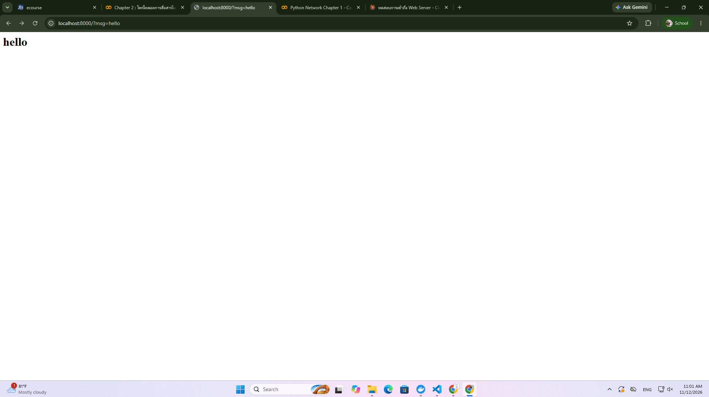
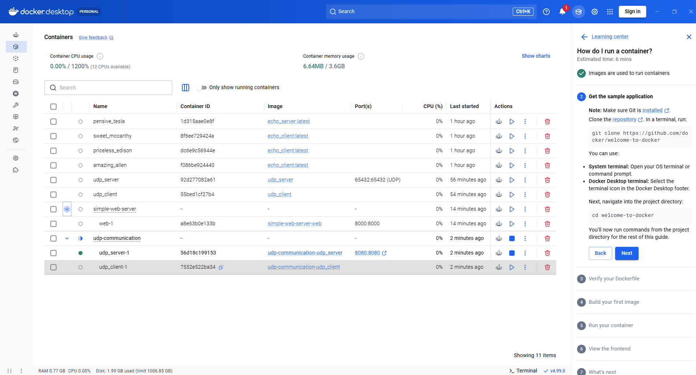

# Chap 2: Docker Web Server & UDP Communication

## 1. Simple Web Server (Flask)

เว็บฟอร์มรับข้อความด้วย Flask รันผ่าน Docker Compose

```bash
cd simple-web-server
docker-compose up --build
```

เปิดเบราว์เซอร์ที่ `http://127.0.0.1:5000`




## 2. UDP Communication

Client ส่งข้อความไปยัง Server ผ่าน UDP

```bash
cd udp-communication
docker-compose up --build
```

